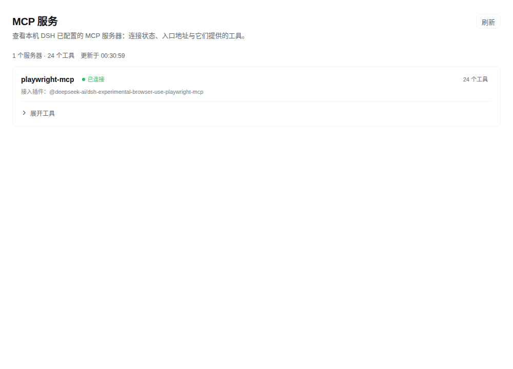
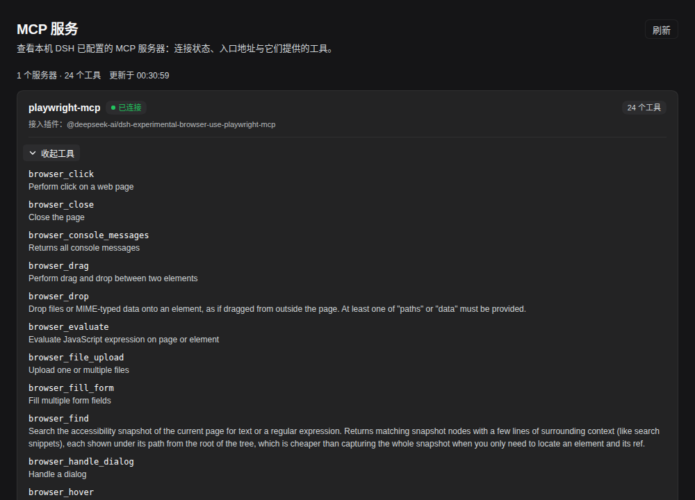

# dsh-mcp-panel

在 DeepSeek Harness Web 的左侧栏「插件」下面加一个 **MCP** 入口，点进去是本机 MCP 服务器的可视化页面：
服务器名、连接状态、接入方式、入口地址（凭据已隐藏）、以及每个服务器提供的工具清单。

## 界面

- 侧栏图标：`dsh-mcp-panel` 注册 `sidebar.panellist`，`id: mcp`，`order: 5`（在「插件」0 与「自动化任务」10 之间）。
- 主面板：注册 `main`，`key: mcp`，侧栏按同一个 id 打开，不需要额外的点击处理。
- 内容：标题 + 更新时间 + 刷新按钮；每个服务器一张卡片，状态点、工具数、传输方式；「展开工具」列出工具名与描述（两行截断）。
- 样式只用 `--dsw-alias-*` 主题 token，跟随深浅色；文案走 Client locale 服务（zh / en，其余语言回落英文）。

## 数据从哪来

Host 半注册 `GET /api/mcp-panel/servers`（走 `connection.fetch`，和官方插件同一套认证通道），每次请求现读：

| 字段 | 来源 |
|---|---|
| 工具清单 | MCP 工具名为 `mcp__<serverName>__<tool>`。MCP 服务器注册的工具在 Agent 作用域里，所以按**每个活跃 Agent 的视图**（`ctx.tools.definitions(agent)`）汇总，再并入全局视图 |
| 服务器名 / 传输 / 入口 | profile 里的 `@deepseek-ai/dsh-mcp-client` 配置行（`serverName`、`transport`、`url` / `command` + `args`） |
| 状态 | 该配置行的 `disabled` 与 cordis fiber 状态（已连接 / 连接中 / 连接失败 / 已停用） |
| 接入插件 | 自带 MCP 服务器的插件行（例如 browser-use Playwright 桥），按行 id 与工具命名空间后缀匹配后显示 `接入插件：…` |

env / headers 只显示条数，从不下发值；URL 去掉账号密码与查询参数并在卡片上注明；`liveAgents` 为 0 时页面提示「当前没有活跃会话，工具清单暂时读不到」。

## 截图

浅色（折叠状态）：



深色（展开 24 个工具）：



## 目录

```
index.js          Host 半：注册快照接口，读 configEditor + tools 后返回 JSON
client.js         Client 半：侧栏入口 + MCP 页面 + 样式 + 词典（纯 JS 模块，无需构建）
cordis.patch.yml  bundle 补丁：插入一行 mcp-panel
locale/*.json     插件管理器列表用的标题与描述（zh / en）
icon.svg          列表与详情页图标
```

## 安装

```bash
# 用插件管理器指向本目录（等价于 dsh plugin add /path/to/dsh-mcp-panel）
plugin_manager(action: "install_bundle", target: "/home/kaijia/codes/dsh-mcp-panel")
```

装好后**刷新一次页面**（新 Client 模块要重新加载才会出现在侧栏）。卸载：

```
plugin_manager(action: "remove_bundle", target: "dsh-mcp-panel")
```

## 已知边界

- v1 只读：只看不改。新增 / 编辑 / 删除 MCP 服务器仍走 `~/.dsh/profiles/web/cordis.patch.yml`；
  Host 侧 `configEditor.edit` 已具备写入能力，下一版可以接到这个页面上。
- 工具清单按活跃会话汇总：没有任何会话时只剩配置行，工具列表为空。
- 自带 MCP 服务器的插件行没有 `serverName`，只能按行 id 后缀配对命名空间；配对不唯一时该行不显示，只显示工具命名空间卡片。
- 与 `@deepseek-ai/dsh-mcp-resources` 这类 MCP 辅助包同名会被识别为「可能自带 MCP」的行，但它不注册工具命名空间，因此不会出现在列表里。
