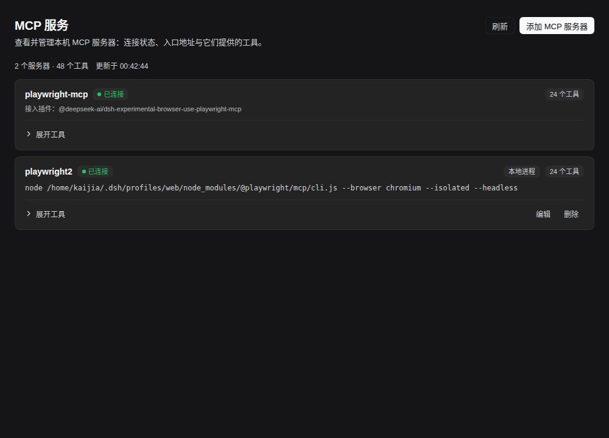
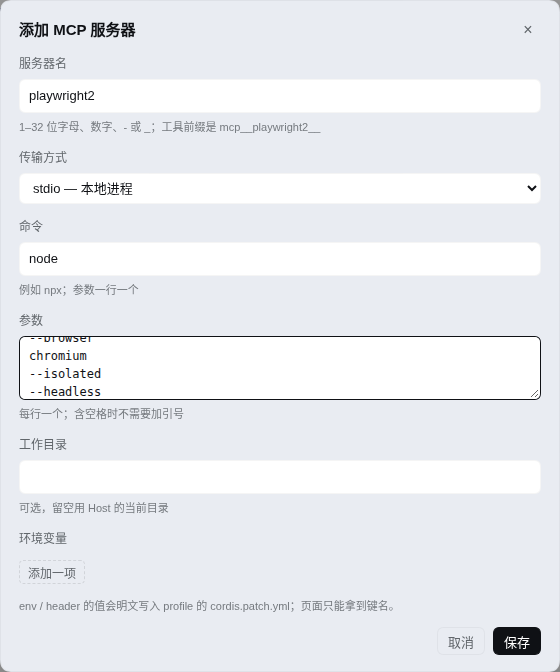
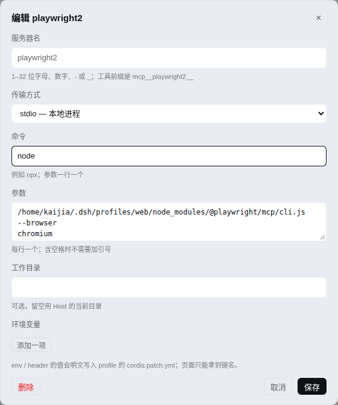
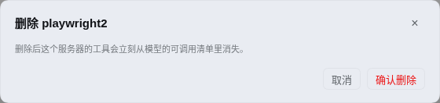

# dsh-mcp-panel

在 DeepSeek Harness Web 的左侧栏「插件」下面加一个 **MCP** 入口，点进去是本机 MCP 服务器的可视化页面：
服务器名、连接状态、接入方式、入口地址（凭据已隐藏）、每个服务器提供的工具清单，**并且可以在页面上直接新增 / 编辑 / 删除服务器**。

## 界面

- 侧栏图标：`dsh-mcp-panel` 注册 `sidebar.panellist`，`id: mcp`，`order: 5`（在「插件」0 与「自动化任务」10 之间）。
- 主面板：注册 `main`，`key: mcp`，侧栏按同一个 id 打开，不需要额外的点击处理。
- 内容：标题 + 更新时间 + 刷新 / 添加按钮；每个服务器一张卡片，状态点、工具数、传输方式；「展开工具」列出工具名与描述（两行截断）；由本页管理的行多一组「编辑 / 删除」。
- 样式只用 `--dsw-alias-*` 主题 token，跟随深浅色；文案走 Client locale 服务（zh / en，其余语言回落英文）。




添加 / 编辑对话框：





删除是单独的确认框，不会被误触：



## 数据从哪来

Host 半注册 `/api/mcp-panel/servers`（走 `connection.fetch`，和官方插件同一套认证通道），每次请求现读：

| 字段 | 来源 |
|---|---|
| 工具清单 | MCP 工具名为 `mcp__<serverName>__<tool>`。MCP 服务器注册的工具在 Agent 作用域里，所以按**每个活跃 Agent 的视图**（`ctx.tools.definitions(agent)`）汇总，再并入全局视图 |
| 服务器名 / 传输 / 入口 | profile 里的 `@deepseek-ai/dsh-mcp-client` 配置行（`serverName`、`transport`、`url` / `command` + `args`） |
| 状态 | 该配置行的 `disabled` 与 cordis fiber 状态；插件已启动但一个工具都没注册时页面显示「未连接（无工具）」 |
| 接入插件 | 自带 MCP 服务器的插件行（例如 browser-use Playwright 桥），按行 id 与工具命名空间后缀匹配后显示 `接入插件：…` |

env / headers 只显示条数，从不下发值；URL 去掉账号密码与查询参数并在卡片上注明；`liveAgents` 为 0 时页面提示「当前没有活跃会话，工具清单暂时读不到」。

## 增删改写到哪

- **新增**：往 profile 的 `cordis.patch.yml` 追加一段
  `- insert: [{ id: mcp-<serverName>, name: '@deepseek-ai/dsh-mcp-client', config: … }]`，写完等 profile 热加载出现该行；
  超时则把文件恢复原样并报错。服务器名按 `mcp-client` 的契约校验（1–32 位字母数字 `-` `_`），并和已有行 / 已有工具命名空间查重。
- **编辑**：调用 Harness 自己的 `ctx.configEditor.edit`，由它校验配置并写 override 行；页面只回填命令、参数、工作目录、地址与键名，
  env / header 的值永远不下发，输入框留空表示保留原值。
- **删除**：从 `cordis.patch.yml` 删掉该 id 的 `insert` 行与所有 override 行，空掉的 `insert` 块一并移除；由插件（bundle）提供的行不可删，页面不给按钮，Host 侧也会拒绝。
- 写入是原子的（临时文件 + rename）、串行化的，并保留写入前的文本用于失败回滚。

## 目录

```
index.js          Host 半：快照接口 + 增删改（读写 profile patch）
client.js         Client 半：侧栏入口 + MCP 页面 + 对话框 + 样式 + 词典（纯 JS 模块，无需构建）
cordis.patch.yml  bundle 补丁：插入一行 mcp-panel
locale/*.json     插件管理器列表用的标题与描述（zh / en）
icon.svg          列表与详情页图标
tests/host.test.mjs  假 ctx + 临时 patch 文件，覆盖快照 / 增删改 / 校验 / 回滚
screenshots/      浅色、深色与三个对话框
```

依赖 `yaml`（读写 profile patch 时保留注释与格式）。`pnpm install` 后即可用；以 `dsh plugin add` 装包时 pnpm 会自动装它。

## 安装

```bash
pnpm install        # 只用链接目录安装时，依赖要自己装
plugin_manager(action: "install_bundle", target: "/home/kaijia/codes/dsh-mcp-panel")
pnpm test           # 可选：跑 Host 半的自测
```

装好或升级后**刷新一次页面**（新 Client 模块要重新加载才会出现在侧栏）。卸载：

```
plugin_manager(action: "remove_bundle", target: "dsh-mcp-panel")
```

## 发布

版本号、tag、GitHub Release、插件市场索引四处必须一起动；少一处，用户看到的还是旧版：

1. `package.json` 的 `version` 加一个补丁号，改动写进提交信息，推 `main`；
2. `git tag vX.Y.Z` 并推 tag；
3. 建 GitHub Release（`gh` 已登录 kaijia323）：
   `gh release create vX.Y.Z -R kaijia323/dsh-mcp-panel --title "vX.Y.Z — <一句话>" --notes-file <notes> --latest`。
   正文照下面的格式：改了什么 / 验证 / 怎么升级，末尾附
   `https://github.com/kaijia323/dsh-mcp-panel/compare/v<上一个>...vX.Y.Z`；
4. 同步市场索引（`gh-pages` 分支的 `index.json`）：在 `versions` 最前面插入
   `{"version": "X.Y.Z", "publishTimestamp": <unix 秒>, "source": {"type": "git", "url": "https://github.com/kaijia323/dsh-mcp-panel", "commit": "<tag 指向的 commit>"}}`，
   提交 `market: publish vX.Y.Z` 推到 `gh-pages`；
5. 核对三处线上状态：`gh release list` 里 `Latest` 是刚发的 tag、
   `https://raw.githubusercontent.com/kaijia323/dsh-mcp-panel/gh-pages/index.json`（立即生效）、
   `https://kaijia323.github.io/dsh-mcp-panel/index.json`（Pages 要等构建），最新版本都必须是刚发的那个。

插件市场索引地址：`https://kaijia323.github.io/dsh-mcp-panel/index.json`，
把它加进 profile 的 `plugin-market` 配置 `indexes` 后，「插件 → 发现」里就能看到这个插件。

发布说明格式：

```markdown
## dsh-mcp-panel X.Y.Z — <一句话>

<为什么改 / 背景>

### 新增 | 修复

- ...

### 验证

- ...

### 升级

插件页 / 市场刷新后更新到 X.Y.Z，或把依赖指到 `github:kaijia323/dsh-mcp-panel#<commit>`。

**对比**：https://github.com/kaijia323/dsh-mcp-panel/compare/v<上一个>...vX.Y.Z
```

## 已知边界

- 工具清单按活跃会话汇总：没有任何会话时只剩配置行，工具列表为空。
- 自带 MCP 服务器的插件行没有 `serverName`，只能按行 id 后缀配对命名空间；配对不唯一时该行不显示，只显示工具命名空间卡片。
- 与 `@deepseek-ai/dsh-mcp-resources` 这类 MCP 辅助包同名会被识别为「可能自带 MCP」的行，但它不注册工具命名空间，因此不会出现在列表里。
- 从页面写入的 env / header 值是明文，存在 profile 的 `cordis.patch.yml` 里；要引用环境变量请在文件里改用 `!!js process.env.X`。
- profile 的热加载来自 HMR 的文件监听（按 mtime 判断），写入失败回滚时也会再触发一次重载。
